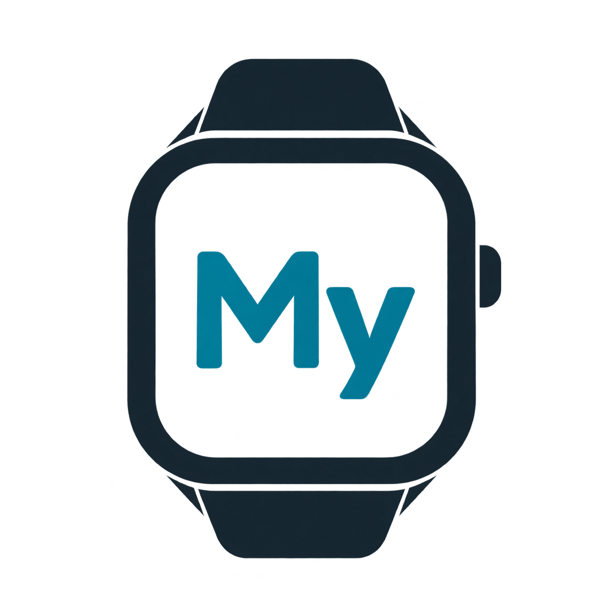

  <picture>
    <source media="(prefers-color-scheme: dark)" srcset="assets/branding/logo-white.png">
    
  </picture>

  <h1>My Dev Watch</h1>

  
<strong>Your watch. Under your control.</strong>

  
An open, local-first companion, watch-face studio and BLE laboratory for 
  GloryFit-family smartwatches. No account, no ads, no telemetry.

  
  
  
  
  
  

---

## What this is

Cheap smartwatches ship with decent hardware and a phone app that owns them: an
account, a cloud, an app store listing that disappears, and health data you cannot
export. My Dev Watch replaces the vendor dependency in stages, and says exactly how
far it has got.

~~~text
control  ->  understand  ->  personalise  ->  modify  ->  replace
~~~

The repository contains three things that share one core:

- **Companion** — Bluetooth, battery, activity, health, notifications, settings.
- **Studio** — watch-face editor, layer by layer, with a real container codec.
- **Laboratory** — BLE command catalogue, capture format, replay, read-only firmware
  analysis, and a CLI that runs every check without a watch.

## Project status

> **Milestone 0 complete, milestone 1 in progress.** The core, the CLI, the codecs
> and the web studio are built and tested. The Android app compiles in CI and is an
> alpha shell: it has not yet been run against a physical watch, and no device is
> listed as verified. There is no firmware flashing code, by design.

## What works today

| Area | Status | Detail |
| --- | --- | --- |
| Protocol identification | **Working** | Weighted, explainable score over GATT facts; below 60 % it says UNKNOWN |
| Battery decode | **Working** | A2 request, percentage answer, validated against a recorded frame |
| Watch-face container | **Working** | Header, length, CRC32, defensive read/write |
| Captures (.mdcap) | **Working** | Parse, serialise, replay through the real protocol stack |
| Firmware analyser | **Working** | SHA-256, entropy, strings, magic detection — read only |
| CLI | **Working** | hex, battery, commands, identify, watchface, firmware, capture |
| Web studio | **Working** | Layers, canvas, simulated values, project export, PWA install |
| Android app | Alpha | Five destinations, scanner, capability matrix, honest empty states |
| Device sync | Not yet | Needs a verified watch and a capture session |
| Watch-face install | Not yet | Needs the transfer protocol proved, with rollback |
| Firmware / open OS | Not yet | Research only; see the roadmap |

## Install

### On a phone, Android or iPhone

  

Scan the code, or open <https://smouj.github.io/my-dev-watch/> on the phone and use
**Add to Home Screen**. The studio works offline after the first load and needs no
account. It is the same application on iPhone and Android, because the native build
cannot be installed on iOS without Apple signing.

To keep projects on your own machine instead of the browser, run the local server:

~~~bash
cd web && npm start
# prints a LAN URL and shows a QR code for your phone
~~~

### On a PC

The same studio runs on the desktop and can talk to the watch directly over
Web Bluetooth in Chrome or Edge (battery read uses the same 0xA2 command as the
core library). The Windows launcher described in [web/README.md](web/README.md)
creates a desktop shortcut.

### Android APK

Built by CI on every push, attached to every tagged release. Installing an APK on
an iPhone is not possible; iOS requires Apple signing and distribution, so the web
studio is the iPhone path.

## Build from source

| Tool | Version |
| --- | --- |
| JDK | 17 |
| Gradle | wrapper 8.10.2 |
| Android SDK | API 35, app module only |
| Node | 20+, web studio only |

~~~bash
./gradlew build                 # core modules, CLI, tests
./gradlew :tools:cli:run --args="commands"
ANDROID_HOME=/path/to/sdk ./gradlew :android:app:assembleDebug
~~~

The Android module is configured only when an SDK is present, so the core build works
on a plain JDK. CI always provides one, which means the app cannot silently rot.

## Compatibility is a ladder

No device is marked "compatible". Each one climbs levels, and each level has an exit
criterion that can be checked by someone else:

| Level | Name | Proof required |
| --- | --- | --- |
| 0 | Detected | Fingerprint stored, protocol hypothesis explained |
| 1 | Communication | Battery and device info without the vendor app |
| 2 | Companion | A full day of use with the vendor app uninstalled |
| 3 | Personalisation | Face replaced and restored, byte-identical |
| 4 | Interface | Icons, menus and themes, each reversible |
| 5 | Firmware | Backup, write and a recovery that was actually executed |
| 6 | Open system | An open firmware boots, shows time and charges |

The current matrix is empty on purpose: [SUPPORTED_DEVICES.md](SUPPORTED_DEVICES.md).

## How the pieces fit

~~~text
android/app ── Compose UI, scanner, capability matrix
     │
     ├── core:protocol-gloryfit ── GATT map, command catalogue, battery
     ├── core:protocol-api ─────── transport contract, registry, fingerprint
     ├── core:capture ──────────── .mdcap parse + replay transport
     ├── core:watchface ────────── container codec, CRC32
     ├── core:firmware ─────────── read-only analysis
     └── core:model ────────────── capabilities, levels, confidence
                │
          tools:cli ──────────── laboratory commands (no radio needed)
~~~

More detail: [ARCHITECTURE.md](ARCHITECTURE.md).

## Evidence, not optimism

Every command in the catalogue carries a level, an evidence string and an
implemented flag:

| Opcode | Command | Confidence | Implemented |
| --- | --- | --- | --- |
| 0xA2 | Battery | PROBABLE | Yes |
| 0xE5 | Live heart rate | OBSERVED | No |
| 0xF7 | Heart-rate history | OBSERVED | No |
| 0x34 | Blood oxygen | OBSERVED | No |
| 0x32 / 0xCB | Sleep variants | OBSERVED | No |
| 0x12 | Notifications | OBSERVED | No |
| 0xF9 | Visible pages | PROBABLE | No |
| 0x6001 | Face transfer | OBSERVED | No |

Read [PROTOCOLS.md](PROTOCOLS.md) before proposing a command, and
[AGENTS.md](AGENTS.md) before writing code. The rules exist because a wrong byte can
destroy somebody's watch.

## Privacy

- No account, no server, no analytics, no advertising SDK.
- Health data stays in the phone database; backups are explicitly excluded.
- Notification content is forwarded, never stored.
- Delete all really deletes. See [PRIVACY.md](PRIVACY.md).

## Repository layout

~~~text
android/app          Compose application (alpha)
core/model           capabilities, levels, confidence, profiles
core/protocol-api    transport contract, registry, identification
core/protocol-gloryfit  GATT map, command catalogue, battery codec
core/watchface       .bin container codec
core/capture         .mdcap format and replay
core/firmware        read-only firmware analysis
tools/cli            laboratory CLI
web                  studio + PWA + LAN installer with QR
docs                 architecture decisions, protocol notes, data model
~~~

## Contributing

Pull requests are welcome, especially device reports with a capture. Start with
[CONTRIBUTING.md](CONTRIBUTING.md). Security issues go through a private advisory,
never a public issue.

## License

Apache-2.0. The brand, the logo and the name "My Dev Watch" are not granted for
derivative distribution; see [NOTICE](NOTICE).
